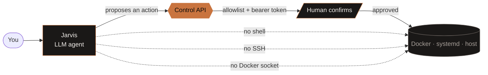
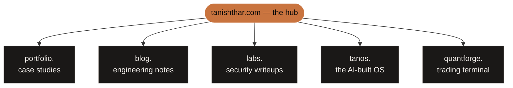

<div align="center">


# Tanish Thar

**AI Product Engineer&nbsp; ·&nbsp; Product Manager&nbsp; ·&nbsp; Agent Builder**

<sub>Mumbai, India</sub>

<br>

<a href="https://tanishthar.com/"></a>
<a href="https://portfolio.tanishthar.com/"></a>
<a href="https://www.linkedin.com/in/tanish-thar/"></a>
<a href="mailto:tanishthar.work@gmail.com"></a>

</div>

---

```console
tanish@TanishsG16:~$ whoami --verbose

  NAME     Tanish Thar
  ROLE     AI product engineer · Computer Engineering, DJ Sanghvi College of Engineering
  BUILDS   AI products · agent systems · deep learning · secure infrastructure
  METHOD   decide what to build, direct the agents, verify every claim before it ships
  PROOF    an OS that boots in QEMU · an agent that cannot reach a shell
           a model that shows which brain region it looked at

tanish@TanishsG16:~$ _
```

I build AI products, and I build them with AI. My job is the part a model cannot do on
its own: deciding what is worth building, designing the boundaries it has to respect,
and proving the result works before anyone else relies on it.

> **How I work.** Coding agents write a lot of my code now. That moves the hard part,
> it doesn't remove it. I set the architecture and the milestones, I break the work
> into pieces an agent can finish, and I check each piece against something that
> cannot be talked round: a test, a boot log, a scan, a real user.

<br>

## Now

| | What | Where it is |
|---|---|---|
| **TanPi + Jarvis** | My Raspberry Pi homelab, run by Jarvis: a private agent with no shell, no SSH and no Docker socket | `in production` · moving every service behind one secure ingress, and teaching Jarvis to remember yesterday without rereading everything |
| **Client websites** | Sites and order systems for small businesses in Mumbai, designed, built and deployed end to end | `shipping` · [work.tanishthar.com](https://work.tanishthar.com/) |
| **TanOS** | How far directed AI agents can take an operating system when held to a real spec | `v0.3 Forge` · next milestone being specified |

<br>

---

## Featured work

> Some codebases are private under commercial or academic constraint. Design specs,
> architecture diagrams and video walkthroughs live on the
> **[case study site](https://portfolio.tanishthar.com/)**. *Click any project to open it.*

<details>
<summary><h3>TanPi + Jarvis &nbsp;—&nbsp; the agent that has no shell &nbsp;&nbsp;<code>FastAPI</code> <code>Docker</code> <code>Pi 4B</code></h3></summary>

<br>

A self-hosted homelab running a private LLM agent that operates real infrastructure,
**and holds no Docker socket, no SSH key, and no shell.**

Most "AI ops" demos hand a model a terminal and hope the prompt holds. That is not a
security boundary, it is a wish. Jarvis reaches infrastructure only through a narrow
**Control API**: bearer token, a server-side allowlist of *logical* services, and
`propose → human confirm → execute` on anything that mutates state.



The dotted lines are the point: they are paths that **do not exist in the codebase**.
There is no `/exec` route, and the API speaks in logical resources rather than
implementation handles, so a compromised prompt has nothing to name.

**Memory that forgets on purpose.** The agent's live store is hard-capped. When it
fills, `add` fails and the model must choose what to drop. A separate systemd unit
exports everything to a durable Markdown archive every 15 minutes. Bounded working
memory, unbounded history, and the import back is manual and validated, never an
automatic round trip.

**Underneath:** Raspberry Pi 4B, Docker Compose, Immich · Jellyfin · Vaultwarden ·
Portainer, Caddy terminating TLS, reachable over a private tailnet. Markdown stays the
source of truth; SQLite is only an index.

**[The write-up: "The agent that has no shell"](https://blog.tanishthar.com/)**

</details>

<details>
<summary><h3>Issue Triage Orchestrator &nbsp;—&nbsp; multi-agent, sandboxed &nbsp;&nbsp;<code>LangGraph</code> <code>Docker</code> <code>FastAPI</code></h3></summary>

<br>

An issue-triage system where three agents collaborate to take a repository issue from
**report → severity → reproduction → proposed fix → failing test → dry-run PR**.

| | |
|---|---|
| **Reliability** | 115+ passing backend tests |
| **Agents** | 3 collaborating, with tool-calling flows and typed state |
| **Safety** | Sandboxed code execution, automated retries, circuit breakers |

**Key decision:** a real-time Next.js dashboard streaming step-by-step reasoning logs,
with `tool_error_rate` and `eval_score` tracked per run. An agent system you cannot
measure is an agent system you cannot trust, so the eval harness shipped with it.

**[Read the case study](https://portfolio.tanishthar.com/projects/issue_triage/)**

</details>

<details>
<summary><h3>TanOS &nbsp;—&nbsp; an operating system built by directing AI agents &nbsp;&nbsp;<code>C</code> <code>x86-64</code> <code>QEMU</code></h3></summary>

<br>

**How far can coding agents take a 64-bit operating system if someone holds them to a
real spec?** TanOS is that experiment. The code was written by AI agents. I set the
architecture and the milestones, broke the work into pieces they could finish, and
refused to accept any version on the strength of "it compiles".

Every version was verified by booting it in QEMU and reading the framebuffer and serial
output through scripted QMP. A milestone counted only when the machine showed it working.

| Version | Codename | Accepted when |
|---|---|---|
| `v0.1` | **Dune** | UEFI loader boots to a graphical desktop that persists across reboots |
| `v0.2` | — | Preemptive multitasking with Ring 3 isolation |
| `v0.3` | **Forge** | Third-party graphical apps build against the platform: 19/19 criteria |

Where it got to: a Ring 3 syscall ABI, an `e1000` network driver, an app store and file
manager, and *Compass*, a browser that renders HTML and a CSS subset over TLS. What it
taught me: an agent is only as good as the acceptance test you give it.

**[Read the case study](https://portfolio.tanishthar.com/projects/tanos/)** &nbsp;·&nbsp; **[tanos.tanishthar.com](https://tanos.tanishthar.com/)**

</details>

<details>
<summary><h3>Alzheimer 3D-MRI Diagnostic AI &nbsp;—&nbsp; explainable &nbsp;&nbsp;<code>PyTorch</code> <code>3D CNN</code> <code>Medical AI</code></h3></summary>

<br>

Stage-wise Alzheimer detection from **raw 3D MRI volumes**, with the model's prediction
mapped back onto the brain regions that produced it.

| | |
|---|---|
| **Data** | 12 disks of OASIS-3 wrangled, 154 subjects segmented |
| **Compute** | ~4 minutes per 3D scan on WSL |
| **Explainability** | Grad-CAM over anatomical segmentation |

**Key decision:** segment the anatomy first, isolating the **hippocampus and
brainstem**, then classify stage-wise on that structure. A radiologist can check *where*
it looked, not just what it said. That is the difference between a number and a
diagnosis someone can act on.

**[Read the case study](https://portfolio.tanishthar.com/projects/alzheimer-detection/)**

</details>

<details>
<summary><h3>QuantForge &nbsp;—&nbsp; low-latency trading stack &nbsp;&nbsp;<code>C++</code> <code>React</code> <code>FastAPI</code></h3></summary>

<br>

A microservices electronic-trading stack: a **C++ price-time-priority matching engine**
with per-symbol locked order books, UDP market data, binary TCP order entry, a Python
pre-trade risk gateway, and a Bloomberg-style web terminal, over Redis pub/sub with
Postgres persistence and Prometheus/Grafana observability.

Co-built with [@hetvipatel31](https://github.com/hetvipatel31).

**[Read the case study](https://portfolio.tanishthar.com/projects/quantforge/)** &nbsp;·&nbsp; **[quantforge.tanishthar.com](https://quantforge.tanishthar.com/)**

</details>

<br>

---

## The Stack

| | |
|---|---|
| **AI / ML** | PyTorch · TensorFlow · LangGraph · LangChain · MCP · Ollama · OpenCV |
| **Product** | MVP scoping · release planning · App Store and Play Store launches · CI/CD |
| **Languages** | Python · TypeScript · JavaScript · C++ · Java · Dart · SQL |
| **Back-end** | FastAPI · Flask · Node.js · Express · Django · PostgreSQL · Redis |
| **Front-end** | React · Next.js · Tailwind · Three.js · Flutter · Vite |
| **Infra** | Docker · Linux · Caddy · Tailscale · Cloudflare · QEMU |
| **Security** | Burp Suite · OWASP Top 10 · IDOR / SSRF · Row-level security |

<div align="center">
  <br>
  <br/>
  <br/>
  
</div>

<br>

---

## Where everything lives

Every project deploys independently on its own subdomain. The hub routes to all of them.



<details>
<summary><b>Wait — a desktop in a browser?</b></summary>

<br>

Yes. On a real screen, [tanishthar.com](https://tanishthar.com/) opens on a lock screen
and then a windowing environment: draggable and resizable windows, a taskbar, a start
menu, a terminal with `ls` / `cat` / `open`, and a music player. Projects that permit
framing run *live inside a window*.

The desktop icons are real `<a href>` elements, so a plain click opens a window while
Ctrl-click, middle-click and crawlers get the actual subdomain. The metaphor never hides
the links behind JavaScript.

On a phone it becomes a home screen with apps, plus an ordinary scrolling page, because a
desktop metaphor on a 5-inch screen is worse than a list.

</details>

<br>

---

<div align="center">

### Get in touch

**[tanishthar.com](https://tanishthar.com/)**
&nbsp; · &nbsp;
**[Case studies](https://portfolio.tanishthar.com/)**
&nbsp; · &nbsp;
**[Writing](https://blog.tanishthar.com/)**
&nbsp; · &nbsp;
**[LinkedIn](https://www.linkedin.com/in/tanish-thar/)**
&nbsp; · &nbsp;
**[Email](mailto:tanishthar.work@gmail.com)**

<br>

<sub>Decide what is worth building. Direct the agents.<br/>Verify everything before anyone relies on it.</sub>

</div>
